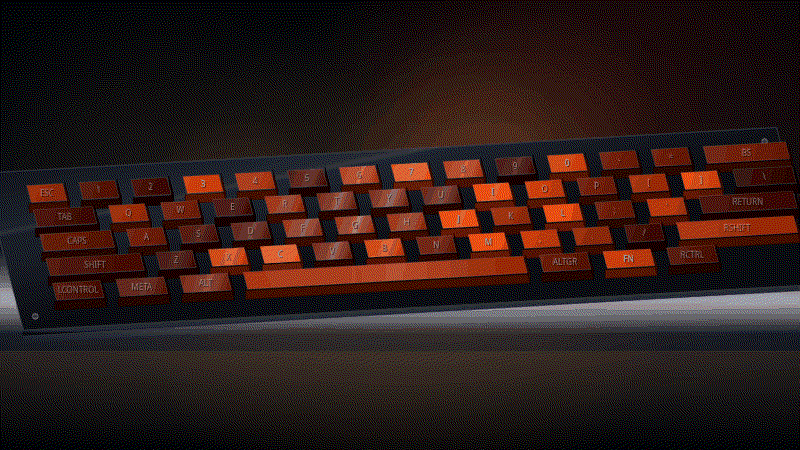

# APEX

**A**daptive **P**eripheral **E**ffect **X**ecutor — a lighting suite for the
SteelSeries **Apex Pro Mini Wireless** (and protocol-siblings) on Linux.

SteelSeries only ships lighting configuration for Windows. APEX talks to the
keyboard's HID control interface directly: no GG, no VM, no Windows. Whole-board
colours, streamed software effects, reactive typing, and a Metalheart /
Neo-Vectorheart GUI with a liquid-metal background and a keyboard preview that
breathes with the board.



> [!CAUTION]
> **APEX is in its earliest development stage.**
>
> It's pre-alpha and full of bugs. Things will break, configs will change, and nothing is stable yet. Don't rely on it — but bug reports and PRs are welcome.

## What you get

| | |
|---|---|
| **Lighting** | any colour, whole board — hardware-verified `0x61`/`0x21` direct frames |
| **Profiles** | JSON files in `~/.config/apexmini/profiles/`; save / import / export / switch on the fly |
| **Effects** | static, gradient, breathing, spectrum, wave, candle (per-key organic flicker) |
| **Reactive typing** | keypresses flash across the board with configurable decay — on the keyboard *and* the GUI preview |
| **GUI** | liquid-metal background, chrome shard field, keyboard preview in two render styles (real-3D / stylized), adaptive neon accents, system tray with profile menu |
| **Daemon** | headless background mode that survives replug/sleep and switches profiles from the CLI or tray |
| **Safety** | the packet builder structurally refuses all profile/flash opcodes — APEX never touches onboard storage |

## Quick start

```bash
# 1. grant your user access to the keyboard's hidraw nodes (one-time)
sudo bash setup/00-grant-access.sh

# 2. GUI (needs the Qt venv, see below)
tools/apexmini-suite
```

Python deps: PySide6 (GUI only) installed into a project-local venv:

```bash
python3 -m venv --copies venv-qt
venv-qt/bin/pip install PySide6
```

The CLI/daemon/protocol core has **zero dependencies** beyond libhidapi.

### CLI

```bash
tools/apexmini list                  # enumerate keyboard control endpoints
tools/apexmini info                  # firmware / battery / brightness probe
tools/apexmini color ff6600          # solid colour
tools/apexmini effect candle         # streamed effect (Ctrl-C → profile)
tools/apexmini onboard               # hand LEDs back to on-board firmware

tools/apexmini-suite use "ocean"     # switch profile (daemon/GUI picks it up)
tools/apexmini-suite daemon &        # headless, replug-proof
tools/apexmini-suite stop            # release LEDs, stop daemon
```

### GUI

`tools/apexmini-suite` — profile builder on the right (animation, palette,
speed, brightness, reactive flash + decay), profile bank at the bottom, tray
icon for switching with the window closed. Closing the window keeps lighting
in the background (checkbox in the status bar). Scroll wheel zooms the
keyboard preview; panels collapse via their header chevrons.

## Hardware support status

| connection mode | PID | direct lighting | status |
|---|---|---|---|
| 2.4 GHz dongle | `0x1624` | `0x61` (642-byte feature frames) | ✅ verified |
| USB cable | `0x1626` | `0x21` (= wireless − 0x40 translation) | ✅ verified |
| Bluetooth | — | not probed yet | ⏳ |

Also expected to work with protocol-siblings (Apex Pro TKL 2023 Wireless,
Apex Pro TKL Gen 3, Apex 9 Mini) — same engine family; probe order covers
them. `tools/apexmini probe` shows which opcode lights *your* board.

Everything we reverse-engineered about the wire protocol (frame layouts,
init sequence, release semantics, the −0x40 cable translation, battery
telemetry) is documented in [`docs/RESEARCH.md`](docs/RESEARCH.md) and
[`docs/cheatsheet.md`](docs/cheatsheet.md).

## Safety statement

APEX only sends lighting frames, an init packet, a release packet and
read-only telemetry (firmware string, battery bytes). The opcodes that
read/erase/write the keyboard's onboard profile storage (`0x83`, `0x02`,
`0x03`, `0x42`, `0x43`, `0xE6`, `0x53`, `0x68`) are forbidden at the packet
layer and enforced by tests. On exit the LEDs are always handed back to the
keyboard's own firmware profile.

## Layout

```
src/apexmini/         protocol core (hidapi ctypes, packet builders, engine)
src/apexmini_gui/     Qt suite (theme, GL background + 3D pass, panels, tray, daemon)
tools/                launchers + RE helpers (probe, render, tests)
docs/                 RESEARCH.md, RUNBOOK-TESTING.md, cheatsheet.md
tests/                offline unit tests (no hardware needed)
udev/ + setup/        access rule + installer
```

## Credits / prior art

* **OpenRGB** (CalcProgrammer1 & contributors) — Apex direct-mode protocol
  families (Gen1 `0x3A`, Gen2/Gen3 `0x40`/`0x61`), init packet, firmware check.
* **OpenGG** (GUHPY) — wireless Gen3 transport semantics (RGB ownership,
  release, battery queries) and the receiver→USB-cable opcode translation
  that APEX verified on the Mini Wireless.
* **steelseriesgg-rs** (Ven0m0) — per-model frame matrix and GG-capture key
  tables used as cross-reference.
* **ApexCtl** (AstroSnail) — the OG Apex Linux controller.

APEX itself is an independent implementation (no code copied from the above);
the hardware facts they published were re-verified live on the Apex Pro Mini
Wireless, including the cable-mode `0x21` path which had not been documented
for this model before.

## License

MIT — see [LICENSE](LICENSE). Use at your own risk; it's your keyboard.
